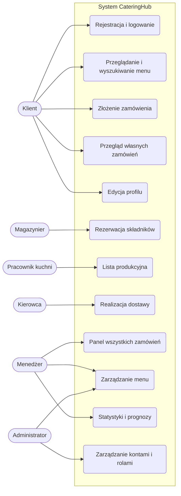

# 5. Specyfikacja wymagań oprogramowania

Rozdział rejestruje wyniki fazy analizy. Opisuje główne funkcje produktu, role
użytkowników, wymagania funkcjonalne i niefunkcjonalne, cele biznesowe oraz analizę
ograniczeń i ryzyka. Zestaw funkcji głównych z punktu 5.1 jest podstawą podziału
systemu na elementy strukturalne architektury opisane w rozdziale 6.

## 5.1 Główne funkcje produktu

| ID | Funkcja główna | Opis | Element architektury | Realizacja |
|---|---|---|---|---|
| F-01 | Obsługa klienta | Rejestracja i logowanie, przeglądanie menu, koszyk, składanie zamówień, historia zamówień | Serwis zamówień (`orders`) | Zrealizowana (raport 1) |
| F-02 | Zarządzanie relacjami z klientami (CRM) | Profil klienta, dane kontaktowe, historia zamówień, alergeny i preferencje, reklamacje | Serwis zamówień (`orders`) | Częściowo: profil i historia |
| F-03 | Planowanie zasobów | Stany magazynowe, przyjęcia składników, rezerwacje i zapotrzebowanie na kolejne dni | Zasoby (`inventory`) | Przyjęcia i rezerwacje planowane na raport 2, planowanie zapotrzebowania na raport 3. |
| F-04 | Zarządzanie relacjami z dostawcami | Katalog dostawców, zamówienia składników, kontrola dostaw surowców | Zasoby (`inventory`) | Opis w architekturze |
| F-05 | Planowanie operacyjne | Lista produkcyjna dla kuchni na wybrany dzień, statusy przygotowania posiłków | Serwis realizacji (`fulfillment`) | Planowana (raport 2) |
| F-06 | Dostawy | Przydział kierowcom według stref, statusy i potwierdzenie doręczenia | Realizacja (`fulfillment`) | Planowana (raport 2) |
| F-07 | Zarządzanie personelem | Konta pracowników, role, grafik i wyznaczanie obsady | Zamówienia (`orders`) obsługują konta i role | Konta i role działają. Grafiki i planowanie obsady należą do wizji pełnego produktu. |
| F-08 | Księgowość | Faktury, płatności, rozliczenia z klientami i dostawcami | Integracja z zewnętrznym systemem księgowym | Opis w architekturze |
| F-09 | Analiza statystyk | Liczba zamówień i porcji, wartość sprzedaży, popularność dań oraz liczba i terminowość dostaw | Zamówienia (sprzedaż), Realizacja (dostawy) | Działa podsumowanie zamówień i porcji. Wartość sprzedaży, popularność dań oraz wskaźniki dostaw są planowane. |
| F-10 | Prognozy | Prognoza zamówień i porcji oraz wyliczenie zapotrzebowania na składniki według receptur | Moduł planowania w Zasobach (`inventory`) | Planowana (raport 3) |

Do realizacji w oprogramowaniu wybrano trzy obszary: obsługę klienta i zamówień
(F-01, F-02), planowanie zasobów i realizację zamówień (F-03, F-05, F-06) oraz
statystyki i prognozy (F-09, F-10). Panel menedżera może połączyć na jednym
ekranie zestawienia pobrane z API poszczególnych usług. Pozostałe funkcje
opisano na poziomie architektury.

## 5.2 Role użytkowników i poziomy dostępu

System przydziela każdemu kontu dokładnie jedną rolę. Rola jest zapisana w koncie
użytkownika i sprawdzana po stronie serwera przy każdym żądaniu. Podczas
samodzielnej rejestracji zawsze nadawana jest rola klienta; role pracowników
nadaje wyłącznie administrator.

| Rola | Opis |
|---|---|
| Klient | Osoba zamawiająca posiłki przez aplikację internetową |
| Magazynier | Pracownik odpowiedzialny za składniki i ich rezerwację pod zamówienia |
| Pracownik kuchni | Przygotowuje posiłki według listy produkcyjnej |
| Kierowca | Realizuje przydzielone dostawy |
| Menedżer | Nadzoruje zamówienia, produkcję, dostawy i statystyki |
| Administrator | Zarządza kontami, rolami i konfiguracją systemu |

Macierz uprawnień (T – pełny dostęp, W – tylko własne dane, O – tylko odczyt, „–” – brak dostępu):

| Element systemu | Klient | Magazynier | Kuchnia | Kierowca | Menedżer | Administrator |
|---|---|---|---|---|---|---|
| Przeglądanie menu | O | O | O | O | O | O |
| Zarządzanie menu | – | – | – | – | T | T |
| Składanie zamówień | T | – | – | – | – | – |
| Przegląd zamówień | W | – | – | – | O (wszystkie) | O (wszystkie) |
| Podsumowanie zamówień i porcji | W | – | – | – | T | T |
| Własny profil | W | W | W | W | W | W |
| Stany magazynowe i rezerwacje | – | T | O | – | T | T |
| Lista produkcyjna | – | O | T | – | T | T |
| Dostawy | W (status) | – | – | W (przydzielone) | T | T |
| Statystyki sprzedaży i wskaźniki dostaw | – | – | – | – | O | O |
| Plan zapotrzebowania na składniki | – | – | – | – | O | O |
| Konta i role użytkowników | – | – | – | – | O | T |

W prototypie z raportu 1 działają wiersze dotyczące menu, zamówień, podsumowań
i profilu; pozostałe opisują stan docelowy.

## 5.3 Interesariusze

| Interesariusz | Oczekiwania wobec systemu |
|---|---|
| Klienci indywidualni i firmowi | Wygodne zamawianie, pewność ceny i terminu, wgląd w status zamówienia |
| Zarząd firmy kateringowej | Niższe koszty, mniej marnowanej żywności, rzetelne dane do decyzji |
| Menedżer operacyjny | Jeden obraz zamówień, produkcji i dostaw na dany dzień |
| Pracownicy kuchni i magazynu | Jednoznaczna lista tego, co i w jakiej ilości przygotować |
| Kierowcy | Czytelna lista dostaw dostępna na telefonie |
| Dział finansowo-księgowy | Poprawne dane o sprzedaży do rozliczeń |
| Dostawcy składników | Przewidywalne zamówienia surowców |
| Dostawca platformy SaaS (producent) | Jedna wersja produktu dla wielu firm, niskie koszty utrzymania |
| Organy nadzoru (UODO, Sanepid) | Ochrona danych osobowych, informacja o alergenach |

## 5.4 Wymagania funkcjonalne

Status: **Z** – zrealizowane w raporcie 1, **P** – planowane w kolejnych etapach.

### 5.4.1 Konta i uwierzytelnianie

| ID | Nazwa | Opis | Status |
|---|---|---|---|
| FR-01 | Rejestracja klienta | Użytkownik zakłada konto, podając e-mail, hasło, imię, nazwisko i opcjonalnie telefon (od 9 do 15 cyfr, dopuszczalne spacje, myślniki i znak + na początku). Adres e-mail jest unikalny bez względu na wielkość liter. Hasło musi spełniać reguły złożoności. | Z |
| FR-02 | Logowanie i wylogowanie | Użytkownik loguje się adresem e-mail i hasłem. Po zalogowaniu system rozpoznaje jego rolę. Wylogowanie kończy sesję. | Z |
| FR-03 | Konfiguracja konta | Zalogowany użytkownik wyświetla swój profil i zmienia imię, nazwisko oraz telefon. Adresu e-mail i roli nie można zmienić samodzielnie. | Z |
| FR-04 | Zarządzanie kontami i rolami | Administrator dodaje, edytuje i dezaktywuje konta pracowników oraz nadaje im role. | Z (panel administracyjny Django) |

### 5.4.2 Menu

| ID | Nazwa | Opis | Status |
|---|---|---|---|
| FR-05 | Wyświetlanie menu | Każdy odwiedzający widzi listę aktywnych dań z nazwą, opisem, ceną, kategorią, alergenami i oznaczeniem dań wegetariańskich. | Z |
| FR-06 | Wyszukiwanie dań | Menu można przeszukiwać według nazwy, opisu i alergenów. | Z |
| FR-07 | Zarządzanie menu | Menedżer i administrator dodają, edytują i wycofują dania. Wycofane danie znika z menu, ale pozostaje w historii zamówień. | Z (panel administracyjny Django, konta z dostępem do panelu) |

### 5.4.3 Zamówienia

| ID | Nazwa | Opis | Status |
|---|---|---|---|
| FR-08 | Koszyk | Klient dodaje dania do koszyka, zmienia liczbę porcji i usuwa pozycje przed złożeniem zamówienia. | Z |
| FR-09 | Złożenie zamówienia | Klient podaje datę dostawy, adres, telefon kontaktowy i uwagi. Zamówienie na następny dzień można złożyć do godziny 18:00, później najbliższy termin to pojutrze; dostawy na bieżący dzień nie są przyjmowane. Numer telefonu musi mieć od 9 do 15 cyfr. Każde danie może wystąpić w zamówieniu raz, liczba porcji mieści się w zakresie 1–1000. | Z |
| FR-10 | Wycena po stronie serwera | Wartość zamówienia jest liczona na serwerze na podstawie aktualnych cen. Cena i nazwa dania są zapisywane w pozycji zamówienia, więc późniejsza zmiana menu nie zmienia historii. | Z |
| FR-11 | Historia zamówień klienta | Klient widzi listę i szczegóły wyłącznie własnych zamówień. | Z |
| FR-12 | Panel zamówień | Menedżer i administrator widzą wszystkie zamówienia, filtrują je po dacie dostawy i wyszukują po danych klienta lub adresie. | Z |
| FR-13 | Podsumowanie dnia | System podaje liczbę zamówień i łączną liczbę porcji dla wybranej daty dostawy. | Z |
| FR-14 | Zdarzenie o zamówieniu | Zamówienia publikują w RabbitMQ `order.submitted`. Zdarzenie zawiera identyfikatory dań, liczbę porcji i datę dostawy potrzebne Zasobom. | Z (publikacja). Odbiór przez Zasoby jest planowany. |
| FR-15 | Anulowanie i zmiana zamówienia | Klient może anulować lub zmienić zamówienie do ustalonej godziny dnia poprzedzającego dostawę. | P |

### 5.4.4 Magazyn i planowanie zasobów

| ID | Nazwa | Opis | Status |
|---|---|---|---|
| FR-16 | Ewidencja składników | Magazynier wyświetla, dodaje, edytuje i usuwa składniki oraz ich stany. | P |
| FR-17 | Receptury | Każde danie ma przypisaną listę składników z ilością na porcję. | P |
| FR-18 | Rezerwacja składników | Po zdarzeniu `order.submitted` system rezerwuje składniki i potwierdza lub odrzuca zamówienie z powodu braków. | P |
| FR-19 | Zapotrzebowanie na składniki | Moduł planowania w Zasobach przelicza zamówione i prognozowane porcje na ilości składników według receptur. | P |

### 5.4.5 Planowanie operacyjne i dostawy

| ID | Nazwa | Opis | Status |
|---|---|---|---|
| FR-20 | Lista produkcyjna | Kuchnia widzi, ile porcji każdego dania przygotować na wybrany dzień. | P |
| FR-21 | Statusy przygotowania | Pracownik kuchni oznacza zamówienie jako przygotowane i spakowane. | P |
| FR-22 | Przydział dostaw | Menedżer przydziela zamówienia kierowcom według stref dostaw. | P |
| FR-23 | Realizacja dostawy | Kierowca widzi przydzielone dostawy i oznacza je jako doręczone lub nieudane. Realizacja zestawia te wyniki dla menedżera i porównuje datę doręczenia z datą planowaną. | P |
| FR-24 | Status dla klienta | Klient widzi aktualny status zamówienia na każdym etapie realizacji. | P |

### 5.4.6 Statystyki, prognozy i raportowanie

| ID | Nazwa | Opis | Status |
|---|---|---|---|
| FR-25 | Statystyki sprzedaży | Zamówienia udostępniają menedżerowi liczbę zamówień i porcji, łączną wartość zamówień według zapisanych cen i popularność dań w wybranym okresie. | Z dla dziennej liczby zamówień i porcji (FR-13). Pozostałe wskaźniki są planowane. |
| FR-26 | Prognoza liczby zamówień | Zasoby prognozują liczbę zamówień i porcji na kolejne dni na podstawie historii zdarzeń, z uwzględnieniem dnia tygodnia. Prognoza jest wejściem do FR-19. | P |
| FR-27 | Współczynniki zasobów | Zasoby wyliczają ilości składników dla prognozowanego popytu. Wyliczanie minimalnej i optymalnej obsady kuchni oraz kierowców należy do wizji pełnego produktu. | P w zakresie składników |
| FR-28 | Raporty | Menedżer może pobrać raport dzienny i okresowy. Źródłem statystyk sprzedaży są Zamówienia, wskaźników dostaw Realizacja, a planu składników Zasoby. | P |

## 5.5 Wymagania niefunkcjonalne

| ID | Nazwa | Opis i sposób spełnienia |
|---|---|---|
| NFR-01 | Bezpieczeństwo uwierzytelniania | Hasła są przechowywane jako skróty Argon2. Token dostępu jest przekazywany w ciasteczku `HttpOnly`, niedostępnym dla skryptów strony. Żądania zmieniające dane wymagają tokenu CSRF. Liczba prób logowania jest ograniczona do 10 na minutę. |
| NFR-02 | Kontrola dostępu | Uprawnienia są sprawdzane po stronie serwera na podstawie roli. Klient nie może nadać sobie innej roli ani zobaczyć cudzych zamówień. |
| NFR-03 | Ochrona danych osobowych | System przetwarza tylko dane niezbędne do realizacji zamówienia, zgodnie z RODO. Każdy serwis ma własną bazę i własne konto bazodanowe, więc ma dostęp wyłącznie do swoich danych. |
| NFR-04 | Niezawodność i spójność danych | Zamówienie, jego pozycje i zdarzenie są zapisywane w jednej transakcji. Awaria kolejki komunikatów nie powoduje utraty zamówienia ani zdarzenia: zdarzenie czeka w bazie i jest publikowane po przywróceniu połączenia. |
| NFR-05 | Dostępność | Docelowo co najmniej 99,5% w godzinach przyjmowania zamówień i realizacji dostaw. Każdy serwis udostępnia punkt kontroli stanu (`/health`). |
| NFR-06 | Wielodostępność | System obsługuje wielu użytkowników jednocześnie. Blokady na poziomie wierszy bazy danych chronią przed błędami przy równoczesnych zamówieniach. |
| NFR-07 | Wydajność | Typowe żądania (menu, lista zamówień) powinny być obsługiwane poniżej 500 ms. Listy są stronicowane po 20 pozycji. |
| NFR-08 | Skalowalność | Serwisy są bezstanowe i można je uruchamiać w wielu kopiach niezależnie od siebie. Kolejka komunikatów wyrównuje chwilowe szczyty obciążenia. |
| NFR-09 | Modułowość | System składa się z niezależnych serwisów odpowiadających funkcjom głównym, komunikujących się przez zdarzenia. Nowy serwis można dodać bez zmian w istniejących. |
| NFR-10 | Prostota i intuicyjność obsługi | Interfejs w języku polskim, czytelne komunikaty błędów, złożenie zamówienia w kilku krokach. Interfejs działa na komputerze i telefonie. |
| NFR-11 | Monitorowanie błędów | Serwisy zapisują zdarzenia i błędy w dziennikach. Wiadomości, których nie udało się przetworzyć, trafiają do osobnej kolejki (dead letter) i mogą być przeanalizowane. |
| NFR-12 | Zgodność ze standardami | Interfejs REST opisany specyfikacją OpenAPI 3; komunikaty w formacie JSON; protokół AMQP dla zdarzeń; typy danych frontendu generowane ze specyfikacji API. |
| NFR-13 | Utrzymywalność | Jednolity styl kodu wymuszany narzędziami (ruff, ESLint, Prettier), testy automatyczne interfejsu API, kod w repozytorium Git. |
| NFR-14 | Przenośność | Infrastruktura uruchamiana w kontenerach Docker, konfiguracja wyłącznie przez zmienne środowiskowe. |
| NFR-15 | Bezpieczeństwo żywności | Alergeny są widoczne przy każdym daniu i można po nich wyszukiwać. |

## 5.6 Cele biznesowe

| ID | Cel | Miernik | Powiązane funkcje |
|---|---|---|---|
| BG-01 | Przeniesienie przyjmowania zamówień do Internetu | Co najmniej 80% zamówień składanych samodzielnie przez klientów | F-01 |
| BG-02 | Ograniczenie błędów w zamówieniach | Odsetek zamówień z błędami danych poniżej 1% | F-01, F-02 |
| BG-03 | Skrócenie planowania produkcji | Lista produkcyjna dostępna w czasie poniżej 5 minut | F-05, F-09 |
| BG-04 | Ograniczenie marnowania żywności | Udział niewykorzystanych składników poniżej 7% | F-03, F-10 |
| BG-05 | Poprawa terminowości dostaw | Co najmniej 95% dostaw w ustalonym oknie czasowym | F-06 |
| BG-06 | Dopasowanie obsady do obciążenia (cel pełnego produktu) | Spadek liczby nadgodzin o 30% | F-07, F-10 |
| BG-07 | Decyzje oparte na danych | Raport dzienny dostępny dla zarządu bez ręcznego zestawiania | F-09 |
| BG-08 | Dostępność produktu dla firm bez działu IT | Uruchomienie nowej firmy na platformie w ciągu jednego dnia | model SaaS |

## 5.7 Analiza ograniczeń

| ID | Rodzaj | Ograniczenie | Wpływ na projekt |
|---|---|---|---|
| C-01 | Czasowe | Trzy terminy raportów (01.12.2026, 15.12.2026, 12.01.2027) | Pierwszy raport dokumentuje obsługę klienta i zamówień. |
| C-02 | Zasobowe | Dwuosobowy zespół projektowy | Realizacja trzech obszarów funkcjonalnych, pozostałe tylko w architekturze |
| C-03 | Budżetowe | Brak budżetu na licencje i płatne usługi | Wyłącznie technologie open source; środowisko uruchamiane lokalnie w kontenerach |
| C-04 | Technologiczne | Uzgodniony stos: Python, Django, React, PostgreSQL, RabbitMQ | Architektura dobrana do możliwości tych narzędzi |
| C-05 | Prawne | RODO, obowiązek informowania o alergenach | Minimalizacja danych, alergeny w menu, kontrola dostępu według ról |
| C-06 | Biznesowe | Posiłki są nietrwałe, a zamówienia mają nieprzekraczalny termin | Zamówienie nie może zostać utracone; data dostawy jest walidowana |
| C-07 | Organizacyjne | Firma kateringowa nie ma działu IT | Model SaaS; brak instalacji po stronie użytkownika, obsługa przez przeglądarkę |
| C-08 | Infrastrukturalne | Kierowcy i kuchnia korzystają z telefonów i tabletów | Interfejs responsywny zamiast aplikacji natywnej |
| C-09 | Integracyjne | Brak dostępu do rzeczywistych systemów płatności i księgowych | Płatności i księgowość poza zakresem prototypu, opisane jako integracje |
| C-10 | Danych | Brak rzeczywistych danych historycznych firmy | Prognozy rozwijane i testowane na danych przykładowych |

## 5.8 Analiza ryzyka

Prawdopodobieństwo (P) i skutek (S) oceniono w skali 1–5. Poziom ryzyka to iloczyn
P × S: 1–6 niskie, 7–14 średnie, 15–25 wysokie.

| ID | Ryzyko | P | S | Poziom | Działania zapobiegawcze i plan awaryjny |
|---|---|---|---|---|---|
| R-01 | Niedotrzymanie terminu raportu przez zbyt szeroki zakres | 4 | 4 | 16 – wysokie | Podział na etapy, priorytet dla jednej funkcji na raport, cotygodniowa kontrola postępu |
| R-02 | Rozbieżność między dokumentacją a kodem | 3 | 3 | 9 – średnie | Dokumentacja w tym samym repozytorium co kod, przegląd rozdziałów przy każdej zmianie architektury |
| R-03 | Złożoność architektury rozproszonej przerasta zespół | 3 | 4 | 12 – średnie | Tylko trzy serwisy, wspólne narzędzia i szablon serwisu, jeden mechanizm komunikacji |
| R-04 | Utrata lub zdublowanie zdarzenia między serwisami | 2 | 5 | 10 – średnie | Zapis zdarzeń w bazie przed publikacją, potwierdzenia dostarczenia, identyfikator zdarzenia do wykrywania duplikatów, kolejka dead letter |
| R-05 | Wyciek danych osobowych klientów | 2 | 5 | 10 – średnie | Skróty haseł Argon2, ciasteczka `HttpOnly`, ochrona CSRF, kontrola ról po stronie serwera, osobne konta bazodanowe |
| R-06 | Błędna wycena zamówienia | 2 | 4 | 8 – średnie | Cena liczona wyłącznie na serwerze, testy automatyczne wyceny |
| R-07 | Awaria infrastruktury dostawcy chmury | 2 | 5 | 10 – średnie | Kopie zapasowe bazy, kontenery możliwe do uruchomienia u innego dostawcy |
| R-08 | Niska trafność prognoz przy małej ilości danych | 4 | 3 | 12 – średnie | Prosty model startowy, wskazanie liczby obserwacji i komunikat przy braku danych do oszacowania popytu |
| R-09 | Przeciążenie w godzinach szczytu zamówień | 3 | 3 | 9 – średnie | Skalowanie serwisów w poziomie, kolejka wyrównująca obciążenie, ograniczenie liczby żądań |
| R-10 | Niechęć pracowników do nowego systemu | 3 | 3 | 9 – średnie | Prosty interfejs dopasowany do roli, dokumentacja użytkownika, wdrożenie pilotażowe |
| R-11 | Niedostępność członka zespołu | 2 | 4 | 8 – średnie | Wspólne repozytorium, opisy commitów, znajomość całości kodu przez oboje |
| R-12 | Zmiana wymagań w trakcie projektu | 3 | 2 | 6 – niskie | Budowa modułowa, wymagania z identyfikatorami ułatwiające śledzenie zmian |

## 5.9 Diagram przypadków użycia

