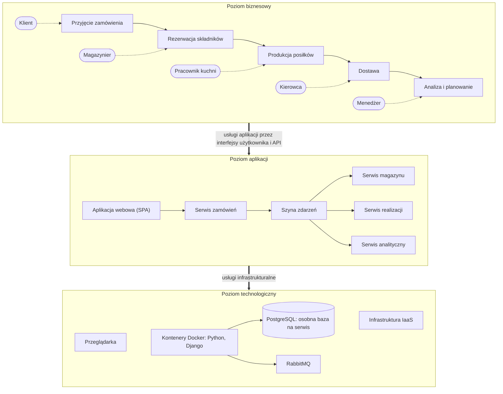
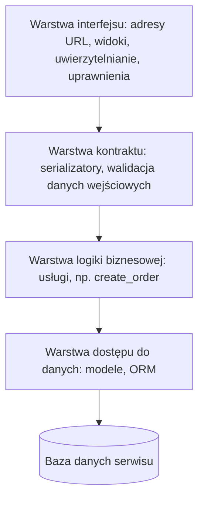
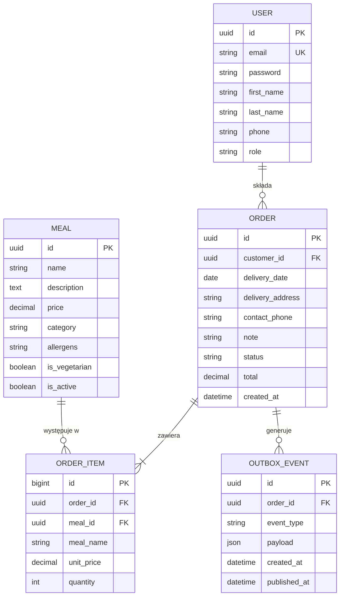
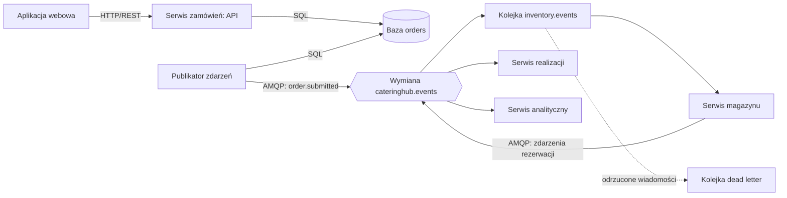
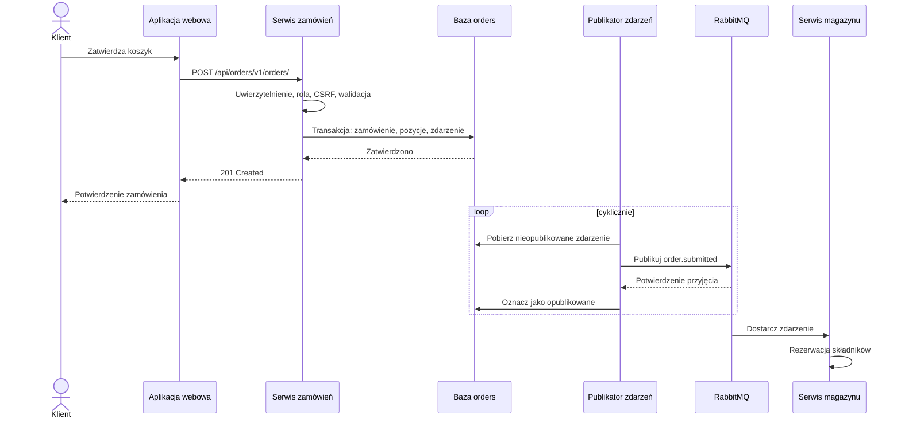
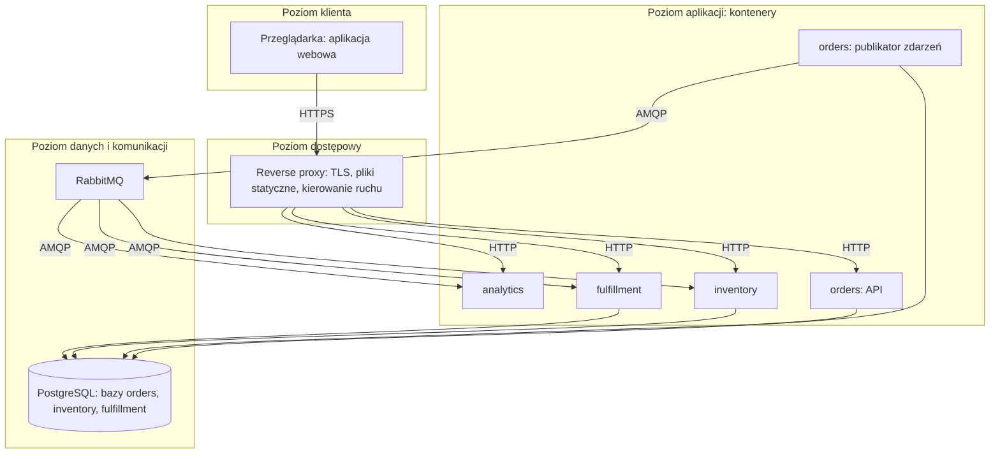

# 6. Architektura produktu

Rozdział rejestruje wyniki fazy projektowania. Przedstawia rozważone warianty
infrastruktury i style architektoniczne, uzasadnia wybór, a następnie opisuje
wybraną architekturę na trzech poziomach (biznesowym, aplikacyjnym
i technologicznym) oraz za pomocą trzech wzorców: modułowego,
komponentowo-łącznikowego i alokacyjnego.

Oceny punktowe w tym rozdziale są szacunkami zespołu projektowego, opartymi na
wymaganiach z rozdziału 5 i literaturze przedmiotu.

## 6.1 Warianty infrastruktury IT

Rozważono trzy sposoby udostępnienia oprogramowania firmom kateringowym.

| Kryterium | A. Każda firma dzierżawi infrastrukturę (IaaS) i sama wdraża system | B. Każda firma buduje własną infrastrukturę | C. Dostawca świadczy usługę SaaS dla wielu firm |
|---|---|---|---|
| Koszt początkowy dla firmy kateringowej | Niski | Bardzo wysoki (serwery, pomieszczenie, sieć) | Brak, opłata abonamentowa |
| Koszt stały dla firmy | Opłata za chmurę i administratora | Energia, serwis, administrator | Abonament |
| Wymagane kompetencje IT w firmie | Wysokie | Bardzo wysokie | Brak |
| Odpowiedzialność za kopie zapasowe i bezpieczeństwo | Firma | Firma | Dostawca |
| Aktualizacje oprogramowania | Każda firma osobno | Każda firma osobno | Jednocześnie dla wszystkich |
| Skalowanie przy wzroście liczby zamówień | Łatwe | Trudne, wymaga zakupu sprzętu | Łatwe, po stronie dostawcy |
| Kontrola firmy nad danymi | Wysoka | Pełna | Ograniczona umową |
| Ryzyko dla firmy | Błędy konfiguracji, brak administratora | Awaria sprzętu, wysoki koszt | Uzależnienie od dostawcy |

**Wybrano wariant C**: producent oprogramowania świadczy usługę SaaS na
infrastrukturze dzierżawionej w modelu IaaS. Decydujące jest ograniczenie C-07
(firma kateringowa nie ma działu IT) oraz cel BG-08 (uruchomienie nowej firmy
w ciągu jednego dnia). Ponieważ system działa w kontenerach i jest konfigurowany
wyłącznie zmiennymi środowiskowymi, ten sam produkt można zainstalować również
w wariancie A lub B dla dużej firmy, która wymaga pełnej kontroli nad danymi.

## 6.2 Wybór stylu architektonicznego

### 6.2.1 Rozważone style

**A. Monolit warstwowy.** Jedna aplikacja i jedna baza danych. Najprostszy
w budowie i wdrożeniu, ale wszystkie funkcje są skalowane i wdrażane razem,
a awaria jednej części zatrzymuje całość.

**B. Monolit modułowy.** Jedna aplikacja podzielona na wyraźne moduły, wspólna
baza danych. Zachowuje prostotę wdrożenia i porządkuje kod, ale moduły nadal
dzielą proces i bazę, więc nie da się ich skalować ani wdrażać niezależnie.

**C. Serwisy funkcji biznesowych sterowane zdarzeniami.** Kilka niezależnych
serwisów odpowiadających funkcjom głównym (zamówienia, magazyn, realizacja,
analityka). Każdy ma własną bazę danych, a serwisy komunikują się asynchronicznie
przez broker komunikatów. Styl łączy cechy architektury mikroserwisowej
i architektury opartej na zdarzeniach.

### 6.2.2 Porównanie według atrybutów jakości

Skala ocen 1–5 (5 – najlepiej). Wagi wynikają z wymagań niefunkcjonalnych.

| Atrybut jakości | Waga | A. Monolit warstwowy | B. Monolit modułowy | C. Serwisy sterowane zdarzeniami |
|---|---|---|---|---|
| Niezawodność (izolacja awarii) | 5 | 2 | 2 | 5 |
| Skalowalność | 4 | 2 | 2 | 5 |
| Modyfikowalność i rozbudowa o nowe funkcje | 5 | 2 | 4 | 5 |
| Wydajność pojedynczego żądania | 3 | 5 | 5 | 4 |
| Bezpieczeństwo (separacja danych) | 4 | 3 | 3 | 5 |
| Testowalność | 3 | 4 | 4 | 3 |
| Prostota wdrożenia i utrzymania | 3 | 5 | 5 | 2 |
| Czas i koszt wytworzenia | 4 | 5 | 4 | 2 |
| **Suma ważona** | | **102** | **108** | **125** |

### 6.2.3 Ryzyka związane z wyborem

| Styl | Główne ryzyko | Prawdopodobieństwo | Możliwa strata |
|---|---|---|---|
| A | Awaria jednej funkcji (np. raportów) zatrzymuje przyjmowanie zamówień | Średnie | Wysoka: utracone zamówienia w godzinach szczytu |
| A, B | Wzrost powiązań między modułami utrudnia dodawanie funkcji | Wysokie | Średnia: rosnący koszt każdej zmiany |
| B | Wspólna baza pozwala modułom czytać cudze dane, co utrudnia późniejszy podział | Średnie | Średnia |
| C | Wyższa złożoność: spójność danych między serwisami, obsługa błędów komunikacji | Wysokie | Średnia: dłuższy czas wytworzenia |
| C | Utrata lub zdublowanie zdarzenia | Niskie przy zastosowanych zabezpieczeniach | Wysoka: zamówienie bez rezerwacji składników |

### 6.2.4 Decyzja

**Wybrano styl C**, ograniczony do niewielkiej liczby serwisów. Uzasadnienie:

- przyjmowanie zamówień jest krytyczne dla firmy i nie może zależeć od
  dostępności magazynu, kuchni czy raportów; w stylu C zamówienie zostaje
  przyjęte, nawet gdy pozostałe serwisy chwilowo nie działają;
- funkcje główne z punktu 5.1 mają różne obciążenie (zamówienia w ciągu dnia,
  produkcja w nocy, prognozy okresowo), więc opłaca się skalować je osobno;
- każdy serwis ma dostęp tylko do własnych danych, co ułatwia spełnienie
  wymagań ochrony danych osobowych;
- kolejne funkcje (księgowość, dostawcy) można dodać jako nowe serwisy
  odbierające istniejące zdarzenia, bez zmian w działającym kodzie.

Ryzyko złożoności ograniczono przez: tylko trzy serwisy w prototypie, jeden
mechanizm komunikacji między nimi, wspólny zestaw narzędzi oraz wzorzec skrzynki
nadawczej (outbox) chroniący przed utratą zdarzeń.

## 6.3 Architektura trójpoziomowa

Opis jest zgodny z podziałem stosowanym w języku ArchiMate: poziom biznesowy
udostępnia usługi klientom, poziom aplikacji wspiera go funkcjami oprogramowania,
a poziom technologiczny dostarcza infrastrukturę, na której działają aplikacje.

### 6.3.1 Poziom biznesowy

| Proces biznesowy | Aktor | Usługa biznesowa | Interfejs |
|---|---|---|---|
| Przyjęcie zamówienia | Klient | Zamawianie posiłków przez Internet | Aplikacja webowa: menu, koszyk, zamówienia |
| Rezerwacja składników | Magazynier | Zapewnienie składników na zamówione posiłki | Panel magazynu |
| Produkcja posiłków | Pracownik kuchni | Przygotowanie posiłków na dany dzień | Lista produkcyjna |
| Dostawa | Kierowca | Doręczenie posiłków pod wskazany adres | Lista dostaw na telefonie |
| Analiza i planowanie | Menedżer | Planowanie zasobów i ocena wyników | Panel zamówień, statystyki, prognozy |

### 6.3.2 Poziom aplikacji

| Komponent aplikacyjny | Funkcje aplikacji | Obsługiwane funkcje główne | Interfejs |
|---|---|---|---|
| Aplikacja webowa (SPA) | Prezentacja menu, koszyk, formularze, panele ról | wszystkie, jako warstwa prezentacji | HTTP, przeglądarka |
| Serwis zamówień (`orders`) | Konta i role, menu, zamówienia, podsumowania, publikacja zdarzeń | F-01, F-02, F-07, F-09 | REST API `/api/orders/v1` |
| Serwis magazynu (`inventory`) | Składniki, receptury, rezerwacje, zapotrzebowanie | F-03, F-04 | REST API, zdarzenia |
| Serwis realizacji (`fulfillment`) | Lista produkcyjna, przydział i statusy dostaw | F-05, F-06 | REST API, zdarzenia |
| Serwis analityczny (`analytics`) | Statystyki, prognoza zamówień, współczynniki zasobów | F-09, F-10 | REST API, zdarzenia |
| Szyna zdarzeń | Przekazywanie zdarzeń biznesowych między serwisami | integracja | AMQP |

W raporcie 1 zrealizowane są aplikacja webowa i serwis zamówień wraz
z publikacją zdarzeń. Bazy danych dla serwisów magazynu i realizacji są już
tworzone w środowisku, a kolejka zdarzeń magazynu jest zadeklarowana.

### 6.3.3 Poziom technologiczny

| Usługa infrastrukturalna | Realizacja | Obsługiwane komponenty |
|---|---|---|
| Wykonywanie aplikacji | Kontenery Docker, Python 3.13, Django 5.2 | Serwisy |
| Przechowywanie danych | PostgreSQL 17, osobna baza i konto dla każdego serwisu | Serwisy |
| Przesyłanie komunikatów | RabbitMQ 4 (protokół AMQP) | Szyna zdarzeń |
| Dostarczanie aplikacji webowej | Serwer plików statycznych i reverse proxy | Aplikacja webowa |
| Sieć i moc obliczeniowa | Infrastruktura IaaS dostawcy chmury | wszystkie |

## 6.4 Wzorzec modułowy

Wzorce modułowe opisują statyczny podział kodu. Zastosowano trzy widoki:
dekompozycję na moduły, wzorzec warstwowy wewnątrz serwisu oraz model danych.

### 6.4.1 Dekompozycja na moduły

| Moduł | Odpowiedzialność | Zależności |
|---|---|---|
| `frontend` | Interfejs użytkownika, komunikacja z API | kontrakt OpenAPI serwisów |
| `orders.accounts` | Użytkownicy, role, rejestracja, logowanie, profil | – |
| `orders.sales` | Menu, zamówienia, podsumowania, skrzynka nadawcza zdarzeń | `orders.accounts` |
| `inventory` | Składniki, receptury, rezerwacje | zdarzenia `order.*` |
| `fulfillment` | Produkcja i dostawy | zdarzenia z `inventory` |
| `analytics` | Statystyki i prognozy | zdarzenia wszystkich serwisów |

Moduły różnych serwisów nie importują nawzajem swojego kodu ani nie czytają
cudzych tabel. Jedyną zależnością między serwisami jest format zdarzenia.

### 6.4.2 Wzorzec warstwowy wewnątrz serwisu

Każdy serwis ma tę samą budowę. Warstwa wyższa korzysta tylko z warstwy
bezpośrednio pod nią.

| Warstwa | Elementy w serwisie zamówień |
|---|---|
| Interfejs | `urls.py`, `accounts/views.py`, `sales/views.py`, `accounts/authentication.py` |
| Kontrakt | `accounts/serializers.py`, `sales/serializers.py` |
| Logika biznesowa | `sales/services.py`, `sales/publisher.py` |
| Dostęp do danych | `accounts/models.py`, `sales/models.py`, migracje |

Zaletą jest czytelny podział odpowiedzialności i łatwe testowanie reguł
biznesowych; wadą niewielki narzut na przejście przez warstwy.

### 6.4.3 Model danych serwisu zamówień

Pozycja zamówienia przechowuje kopię nazwy i ceny dania z chwili zakupu.
Ograniczenia w bazie danych dodatkowo pilnują, by cena i liczba porcji były
dodatnie, a danie nie powtarzało się w jednym zamówieniu.

## 6.5 Wzorzec komponentowo-łącznikowy

Wzorce komponentowo-łącznikowe opisują system w czasie działania: komponenty
i połączenia między nimi.

### 6.5.1 Komponenty i łączniki

| Komponent | Rola |
|---|---|
| Aplikacja webowa | Klient interfejsu REST, działa w przeglądarce |
| Serwis zamówień (API) | Serwer REST, zapisuje zamówienia i zdarzenia |
| Publikator zdarzeń | Proces przenoszący zdarzenia ze skrzynki nadawczej do brokera |
| Broker komunikatów | Rozdziela zdarzenia do kolejek subskrybentów |
| Serwisy magazynu, realizacji, analityczny | Subskrybenci zdarzeń |
| Bazy danych | Trwałe przechowywanie danych każdego serwisu |

| Łącznik | Między | Styl | Charakter |
|---|---|---|---|
| HTTP/REST, JSON | Aplikacja webowa i serwis | klient-serwer | synchroniczny |
| SQL | Serwis i jego baza | dostęp do danych | synchroniczny |
| AMQP, wymiana typu `topic` | Publikator, broker, subskrybenci | publikuj-subskrybuj | asynchroniczny |

### 6.5.2 Scenariusz: złożenie zamówienia

Zastosowano wzorzec skrzynki nadawczej (transactional outbox). Zdarzenie jest
zapisywane w tej samej transakcji co zamówienie, a do brokera trafia dopiero
w drugim kroku. Dzięki temu nie może powstać zamówienie bez zdarzenia ani
zdarzenie bez zamówienia, a awaria brokera opóźnia jedynie publikację. Skutkiem
ubocznym jest możliwość dwukrotnego dostarczenia zdarzenia, dlatego każde
zdarzenie ma unikalny identyfikator, po którym odbiorca rozpoznaje duplikaty.

### 6.5.3 Zdarzenia domenowe

| Zdarzenie | Publikuje | Odbiera | Status |
|---|---|---|---|
| `order.submitted` | Serwis zamówień | Magazyn, analityka | Zrealizowane (publikacja) |
| `stock.reserved` | Magazyn | Zamówienia, realizacja | Planowane |
| `stock.rejected` | Magazyn | Zamówienia | Planowane |
| `order.prepared` | Realizacja | Zamówienia, analityka | Planowane |
| `delivery.assigned` | Realizacja | Zamówienia | Planowane |
| `delivery.completed` | Realizacja | Zamówienia, analityka | Planowane |

## 6.6 Wzorzec alokacyjny

Wzorce alokacyjne pokazują rozmieszczenie oprogramowania na infrastrukturze.
Zastosowano widok wdrożenia w układzie wielopoziomowym (multi-tier).

| Element oprogramowania | Środowisko deweloperskie (stan obecny) | Środowisko docelowe (SaaS) |
|---|---|---|
| Aplikacja webowa | Serwer deweloperski Vite, port 5173 | Pliki statyczne za reverse proxy |
| Serwis zamówień | Proces Django, port 8001 | Kontener, wiele kopii |
| Publikator zdarzeń | Polecenie uruchamiane lokalnie | Osobny kontener |
| PostgreSQL | Kontener Docker Compose, port 55432 | Usługa bazy danych z kopiami zapasowymi |
| RabbitMQ | Kontener Docker Compose, porty 5672 i 15672 | Kontener lub usługa zarządzana |
| Kierowanie ruchu `/api/orders` | Proxy serwera Vite | Reverse proxy |

Każdy poziom można skalować niezależnie. Poziom danych jest dostępny wyłącznie
z poziomu aplikacji, a każdy serwis łączy się z bazą własnym kontem.

## 6.7 Wpływ architektury na atrybuty jakości

| Atrybut | Taktyka architektoniczna |
|---|---|
| Niezawodność | Skrzynka nadawcza, trwałe kolejki, potwierdzenia dostarczenia, kolejka dead letter, punkt kontroli stanu |
| Skalowalność | Bezstanowe serwisy, kolejka wyrównująca obciążenie, osobne skalowanie poziomów |
| Bezpieczeństwo | Token w ciasteczku `HttpOnly`, ochrona CSRF, kontrola ról na serwerze, osobne konta bazodanowe, ograniczenie liczby żądań |
| Modyfikowalność | Serwisy według funkcji biznesowych, komunikacja przez zdarzenia, kontrakt OpenAPI |
| Spójność danych | Transakcje, blokady wierszy, ograniczenia w bazie danych |
| Testowalność | Logika biznesowa w osobnej warstwie, testy automatyczne interfejsu API |
